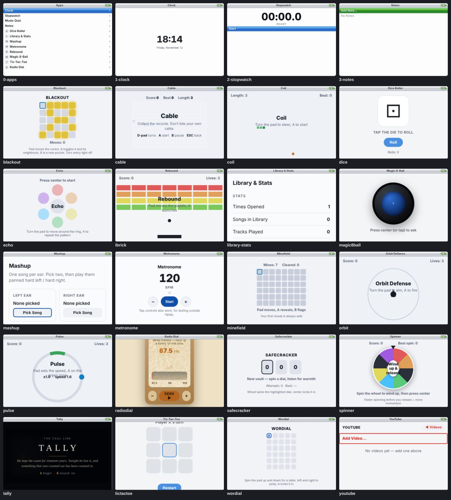
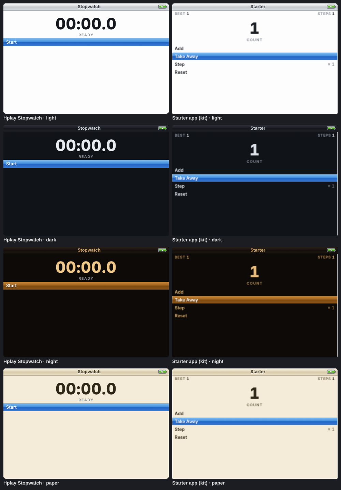

# Making an app that belongs in Hplay

Every app in Get More runs on Hplay's screen, under Hplay's title bar, driven by Hplay's wheel.
If it looks and moves like the rest of Hplay, it feels like part of the device. If it doesn't,
it feels like a web page somebody dropped in. Until now each app invented its own look, and
side by side they look like twenty different products:



This guide is the fix. Every number in it was **measured from Hplay itself**: its rows, its
title bar, its Stopwatch, on three phone sizes and in all five screen modes. Follow it and an app
looks like this, next to Hplay's own Stopwatch:



**Start every new app from [`starter.html`](starter.html).** It has the kit (the CSS and the few
lines of script below) and a tiny working app that uses it. Copy it, rename it, keep the kit
block as it is.

---

## 1. The screen you get

The app fills the space **under Hplay's title bar**. The title bar already shows the app's name,
the battery and Hplay's look; the app gets everything below it.

| | |
|---|---|
| Shape | **359 × 224 units**, the same on every phone (about 3:2, landscape) |
| In pixels | about 310 × 193 on a small phone, 335 × 209 on a typical one, 354 × 221 on a big one |
| One unit (`u`) | **1/224 of the app's height**. In CSS: `calc(100vh / 224)`, which the kit sets as `--u` |

**Size everything in `u`.** Never in `px`, `vw`, `vh` or `rem`. That is the whole reason the
apps look different today: `13px` on a screen whose rows are 9.8u is a third bigger than
anything Hplay draws, and it does not follow the phone or the Text Size setting.

Nothing may spill outside the 359 × 224. There is no scrolling of the page itself (the kit sets
`overflow:hidden`); anything that does not fit is a list that the wheel moves through (§5).

## 2. Type

Hplay uses one typeface stack, `"Helvetica Neue", Helvetica, Arial, sans-serif` (the kit's
`--font`), and a small fixed set of sizes. Use only these, and **no more than three of them on
one screen**.

| Role | Size | Weight | Colour | Kit class | Where Hplay uses it |
|---|---|---|---|---|---|
| Row text, anything you read | **9.8u** | 600 | `--fg` | `.row` | every list |
| A value on a row, secondary facts | 9.8u | 500 | `--val` | `.row .val` | "120 BPM", "On", counts |
| Something not available | 9.8u | 500 | `--dim` | `.row.dim` | "No Notes" |
| Caption, status, labels | **8u**, CAPITALS, spaced | 700 | `--hint` | `.cap`, `.status` | "READY" under Stopwatch |
| One line of help | 8u | 600 | `--hint` | `.hint` | |
| A splash heading | **14u** | 800 | `--fg` | `.splash .t` | "Need more music" |
| A splash line | 9u, line height 1.6 | 400 | `--val` | `.splash .s` | |
| The big number | **34u**, tabular figures | 800 | `--fg` | `.big` | Clock, Stopwatch, sleep timer |

What the store apps do today, for comparison: body text 11 to 14u, headings 15 to 18u, one app
in Georgia. Everything is simply too big and too varied.

**Never write the app's name on the screen.** The title bar already says it. Fifteen of the
twenty apps repeat it as a big heading, which is the single most "web page" thing about them.

## 3. Colour

The app's background is **Hplay's screen**, not a colour of its own. Hplay has five screen
modes, and the kit has all of them:

| Mode | Background `--bg` | Text `--fg` | Values `--val` | Highlight |
|---|---|---|---|---|
| Light | `#fdfdfe` | `#1c1f24` | `#7a7f87` | the blue bar |
| Dark | `#101318` | `#dde2e9` | `#7a7f87` | the blue bar |
| High Contrast | `#000000` | `#ffffff` | `#c9c9c9` | flat `#0060df`, no gradient |
| Night | `#0d0a07` | `#e8bd7e` | `#a8814f` | an amber bar |
| Paper | `#f4ecd8` | `#2f2718` | `#7d7059` | the blue bar |

Today every store app paints its own background instead: five different near-white greys, one
black, one beige wood. None of them change in Dark.

**Colours that mean something** come from Hplay's row accents, and only these:

| Colour | Means | Kit |
|---|---|---|
| Blue | where you are (the highlight) | `.sel` |
| Green | start, add, correct, go | `.acc-green`, `--green` |
| Red | remove, wrong, lose a life | `.acc-red`, `--red` |
| Orange | being changed right now | `.acc-orange`, `--orange` |
| Purple | special, rare, bonus | `.acc-purple`, `--purple` |

A game may use them for its pieces (bricks, lights, segments), at full strength or faded, plus
`--well` for empty cells and `--line` for thin rules. No rainbows of its own, no pastel sets,
no textures, no photos as backgrounds.

## 4. Focus: the highlight bar

In Hplay, where you are is **always one blue bar**, full width, glossy, white text: the same
gradient on every list. It is the most recognisable thing on the screen. Apps must use it.

- **In a list**, the focused row gets `.row.sel`: the bar, exactly as Hplay draws it.
- **In a grid or board** (a game), the focused cell gets `.cell.sel`: the cell filled with the
  same gradient. Not an outline, not a glow, not a different blue.
- **Exactly one thing is focused, and it is always visible.** If the wheel does something, the
  person must be able to see what it is about to act on.
- **A value being changed** turns its bar orange (`.acc-orange`) until centre is pressed again.
  That is how a setting is changed in Hplay.

Today most store apps show focus as a thin outline (Blackout, Minefield, Tic-Tac-Toe,
Safecracker, Wordial, Mashup) or a red box (YouTube). On a 200-pixel screen an outline is
very hard to find.

## 5. The wheel: how moving works

These are Hplay's own rules; an app that breaks them feels broken, even if it works.

| Input | Message | What it should do |
|---|---|---|
| Turn clockwise | `{type:'wheel', dir:1, mult}` | move **down / next / more** |
| Turn anticlockwise | `{type:'wheel', dir:-1, mult}` | move **up / back / less** |
| Centre | `{type:'select'}` | **do the focused thing** |
| MENU | (not sent) | Hplay leaves the app; nothing to do |

- **One click of the wheel is one step.** One row, one cell, one number. `mult` is above 1 on
  a fast spin: use it to move faster through long lists or big ranges, ignore it where precision
  matters (aiming, a combination lock).
- **At the end of a list, stop.** Do not wrap round to the top on the same turn. (Hplay wraps
  only on a second, separate turn; stopping is the safe copy of that.)
- **The list scrolls only when the highlight reaches its edge,** a whole row at a time, with no
  smooth scrolling, no centring, no momentum. About 13 rows fit under a title bar; with a status
  line or a big number above them, fewer.
- **The highlight never wraps text.** A row is one line; long text ends in "…".
- Keep touch working underneath (tapping a row does it), but design for the wheel. Never write
  "tap" on the screen.

**D-pad apps** (`"controls":"dpad"` in the manifest) get `up`, `down`, `left`, `right`, `a`, `b`
and `esc` instead. The same rules apply: one press is one step, `a` is centre, the focus is the
bar or the filled cell, and `esc` is the app's own back (answer `{type:'handled'}` if you used it).

## 6. No buttons

Hplay has **no buttons**: every action is a row. Pills, rounded "Roll" buttons, `−` and `+`
circles and outlined boxes are what make an app look like a website.

| Instead of | Use |
|---|---|
| A "Start" / "Roll" / "Play" button | a row: **Start**, with `.acc-green` |
| `−` 120 `+` | a row **Tempo   120 BPM**; centre turns it orange, the wheel changes it, centre sets it |
| Two choice buttons side by side | two rows |
| "Restart" under a game | the game-over splash says "Press centre to play again" |
| A card with a border | nothing: rows on the background, as Hplay does |

## 7. Four layouts

Almost every app is one of these. Pick one; do not invent a fifth unless none fits.

1. **List** (Library & Stats, YouTube, Mashup). Rows from the top, highlight bar, values on the
   right. Exactly like Hplay's Settings or Statistics.
2. **Big number** (Metronome, Dice, a timer). The big number at the top with its caption, rows
   under it. Exactly like Hplay's Stopwatch. See `starter.html`.
3. **Game** (Rebound, Coil, Orbit, Pulse, Minefield…). A **status line** at the top (15u: two or
   three facts like `SCORE 120` and `LIVES 3`, in `.status`), the playfield under it, and
   nothing on top of the playfield while it is being played.
4. **Splash**, for the moments in between: before a game starts, paused, game over, empty. A
   14u heading, one or two 9u lines, centred, nothing else (`.splash`). It replaces the
   playfield; it is never drawn over moving pieces.

## 8. Words

- **At most one line of help**, 8u, at the bottom (`.hint`), and only where it is needed to start.
  Today several apps carry two or three lines of instructions all the time.
- Write what to do, with Hplay's words: **Turn** the wheel, press **centre**, **MENU**. For d-pad
  apps: the **pad**, **A**, **B**.
- Rows in Title Case, like Hplay's ("Take Away", "Cover Style"), with no full stop.
  CAPITALS only in the 8u captions and the status line.
- Never "Tap", "Click", "Button", or a note meant for the developer ("Tap controls also work,
  for testing outside Hplay").

## 9. Theme: what Hplay tells an app

**Planned for the next Hplay version; v44.1.0 does not send it yet.** Hplay will send this once
the app has loaded, and again whenever the screen mode or text size changes:

```js
{ channel:'hplay', type:'theme', mode:'light'|'dark'|'contrast'|'night'|'paper', u:<px> }
```

The kit's script half handles it: it sets `data-mode` on the page (which switches the colours)
and `--u` (which follows Hplay's Text Size setting). Until then, and on any older Hplay, nothing
arrives and the app stays in Light, sized from its own height. So an app written to the kit
today is already right, and starts following Dark the day Hplay sends the message.

## 10. Motion

- Move things with `transform` and `opacity` only; nothing else should animate all the time.
- Respect reduced motion (the kit stops every animation when the phone asks).
- Stop timers and drawing while the app is not in view (`document.hidden`).

## 11. Before publishing: the checklist

- [ ] Started from `starter.html`; the kit block is unchanged.
- [ ] Nothing is sized in `px`, `vw` or `vh` (search the file).
- [ ] The app's name is not on the screen.
- [ ] No `<button>` looks like a button; every action is a row or the centre press.
- [ ] Focus is the bar or a filled cell, and something is always focused.
- [ ] One wheel click is one step; lists stop at the ends.
- [ ] At most one line of help.
- [ ] Looked at inside Hplay, in Light, Dark and Night, on a small (360 × 780) and a big
      (412 × 915) phone: nothing cut off, nothing overlapping.
- [ ] Put next to Hplay's own Stopwatch or Settings: same sizes, same bar, same background.

---

## Where every app stands today

Measured inside Hplay on a 390 × 844 phone (picture at the top). Sizes in `u`; Hplay's own text
is 9.8u.

| App | Layout | Text | What has to change |
|---|---|---|---|
| Dice Roller | big number | 11–58u | Die card and blue "Roll" pill → die as the big glyph, a green **Roll** row; "TAP THE DIE" goes |
| Library & Stats | list | 12–18u, runs off the bottom | Name heading goes; rows at 9.8u with values on the right; the wheel moves the bar, not the page |
| Mashup | list | 12–18u, runs off the bottom | Heading, paragraph and two bordered cards → rows **Left Ear ›**, **Right Ear ›**, **Play** |
| Metronome | big number | 10–36u | Heading goes; pill `−` Start `+` → rows **Start** and **Tempo 120 BPM** (orange while changing); the developer note goes |
| Rebound | game | 12–17u | Title and help are drawn over the bricks → start splash; rainbow bricks → the accent colours |
| Magic 8-Ball | big number | 8–12u | Closest already; flatten the ball into the palette; help line to 8u |
| Tic-Tac-Toe | game | 13u, cut off top and bottom | "Player X's turn" is under the title bar and Restart is cut off → status line, board fitted, game-over splash |
| Radio Dial | big number | 9–20u, cut off at the top | Beige wood background → Hplay's screen; the dial stays one drawn object in the palette; top text fitted |
| Orbit Defense | game | 12–17u | Title and help over the playfield → start splash |
| Echo | game | 10–16u | Pastel circles → the accents; "Echo" heading in the middle goes |
| Coil | game | 12–17u | Title and help over the snake → start splash |
| Wordial | game | 10–13u | Heading goes; outline focus → filled cell |
| Spinner | game | 10–13u | Text over the wheel's hub; two lines of help → one |
| Safecracker | game | 10–18u | Heading goes; outline focus → filled cell; three lines of text → status line plus one hint |
| Pulse | game | 12–17u | Title and help over the ring → start splash |
| Blackout | game | 10–13u | Heading goes; outline focus → filled cell; two lines of help → one |
| Minefield | game | 10–11u | Outline focus → filled cell; two lines of help → one |
| YouTube | list | 11–13u | "YOUTUBE" heading and red box focus → rows with the bar |
| Cable | game | 11–20u | Big heading and the instructions box → start splash |
| Tally | story | 9–29u, Georgia | Its own black page and serif → Hplay's screen and type; the mood comes from the words, not the paper |

Across all twenty: 15 repeat their name, all 20 paint their own background (seven different ones),
7 show focus as an outline or a box, 6 have web buttons, 4 run off the screen, none follow Dark.

## What Hplay itself still needs (for the app, not this repo)

Recorded here so the two halves stay in step; these go into the next app version:

1. Send the `theme` message (§9) when an app opens and when the mode or text size changes.
2. The frame behind an app is white (`.extHost`), so a dark-mode app flashes white while it
   loads. It should be the screen's own colour.
3. The frame is placed at fractional pixel positions, which makes the app's text slightly soft
   next to Hplay's. Round the position to whole pixels.
